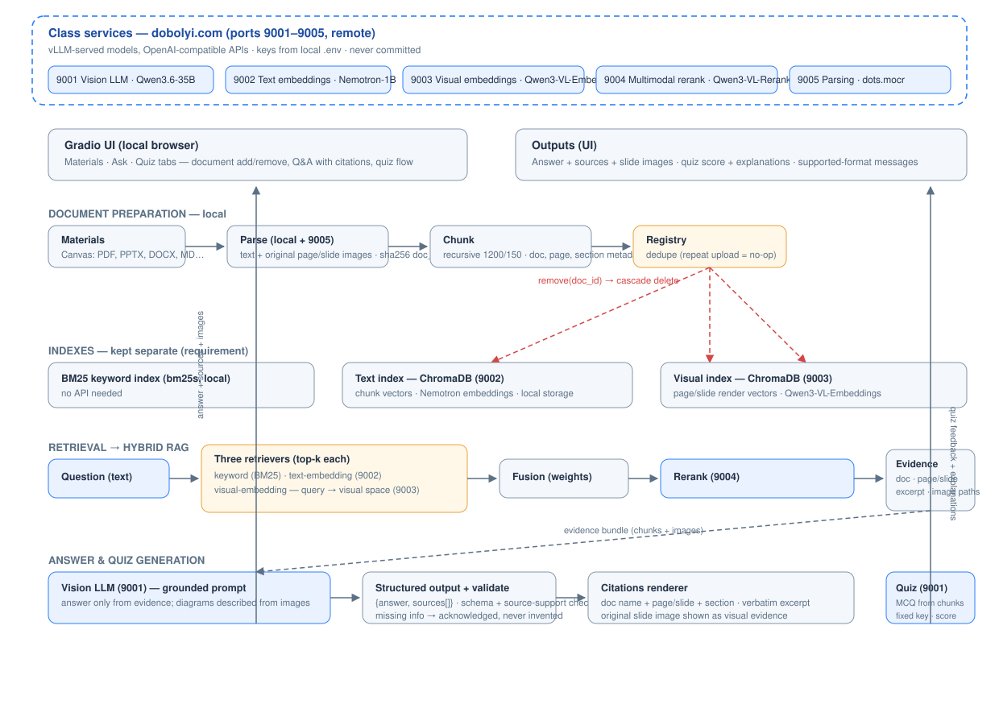
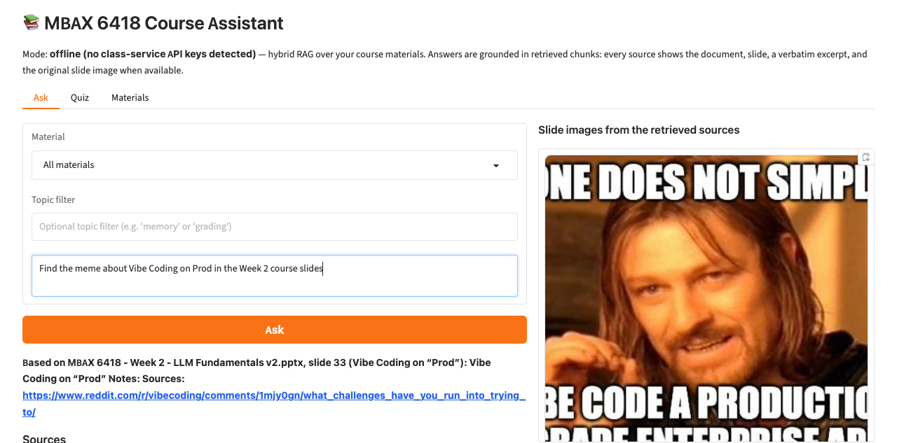
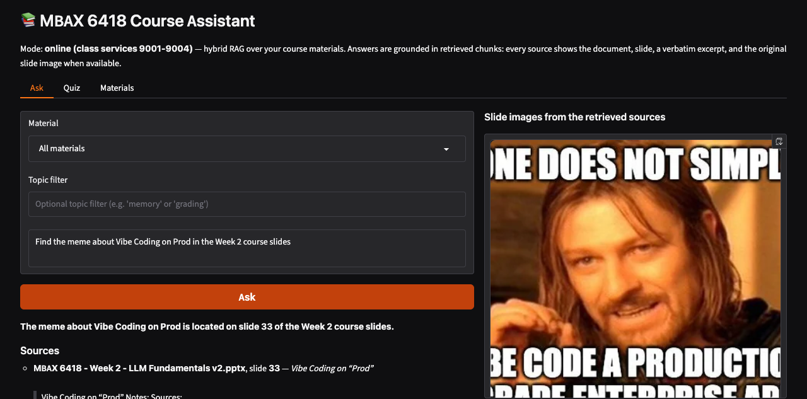
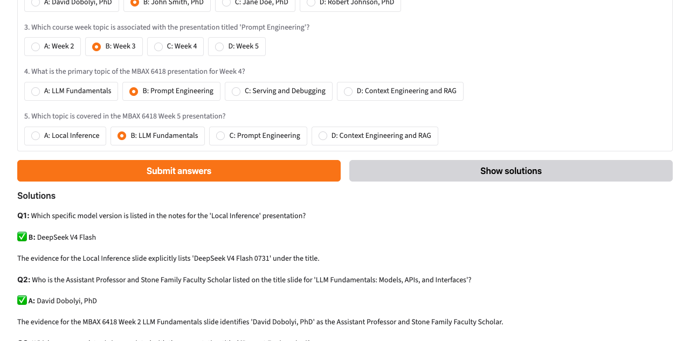
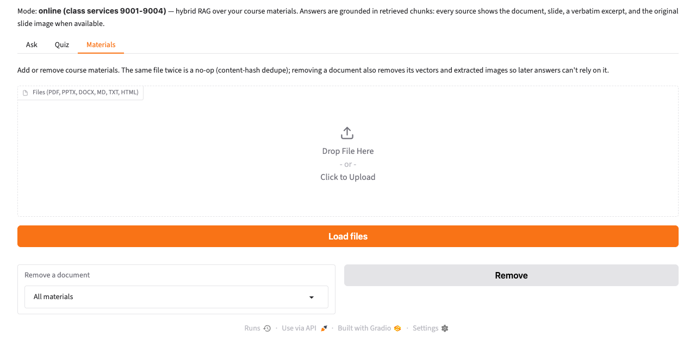

# 🎓📚 MSBA Course Assistant

[](.github/workflows/ci.yml)
[]()
[]()
[]()

A course assistant that **answers questions about the course materials** and
**generates practice quizzes** from the class slides, syllabus, and other
files. Built as hybrid retrieval-augmented generation (RAG): keyword search +
text embeddings + visual embeddings, fused and reranked, so every answer is
grounded in citable evidence — document, slide, verbatim excerpt, and the
original slide image.

## 🚀 Try the app

▶ **Live demo:** https://e9464bac676dc72b30.gradio.live
*(temporary share link — up to ~1 week; recreate with `SHARE=1 python app.py`)*

Run it locally in one command after installing (see [Running the app](#running-the-app)):

```bash
python app.py        # → http://127.0.0.1:7860
```

---

## 🎯 What it does

| Feature | Behavior |
|---|---|
| **Grounded Q&A** | Ask about the syllabus, slides, or notes in the **Ask** tab. The app retrieves the most relevant evidence — keyword (BM25 with word-form matching) + text embeddings + visual embeddings — fuses it (reciprocal-rank fusion) and reranks it, then answers **only from that evidence**. The model also sees up to three downscaled slide renders, so slides whose text extraction under-reads are still answerable, and rephrased/synonym questions land on the right material (e.g. "how is my grade calculated?" finds the syllabus breakdown). |
| **Citable sources** | Every answer carries its sources: document, page/slide, section, a verbatim excerpt, and the original slide image for visual questions (e.g. locating a meme in the Week 2 deck). |
| **No invented answers** | Answers come back as a validated JSON with separate `answer` and `sources` fields; any citation the model tries to invent is dropped, and questions the materials can't answer are acknowledged as such. |
| **Practice quizzes** | The **Quiz** tab generates 2–5 multiple-choice questions grounded in a chosen material (plus optional topic filter). Questions are stand-alone concept questions (never "according to the Week 2 deck…"), the answer never appears in the question text, options are balanced so the key isn't guessable by length, the correct option's position is randomized, and each question covers a different slide. The answer key is fixed server-side, **solutions stay hidden until you answer or click *Show solutions***, scores match the key exactly, and explanations cite their sources. |
| **Material management** | The **Materials** tab loads PDF/PPTX/DOCX/MD/TXT/HTML files (deduplicated by content hash) and removes them — vectors, images, and registry go together. |
| **Online / offline modes** | With the class-service API keys, everything runs on the real models (vision LLM, text + visual embeddings, reranker). Without keys the app still boots and runs — keyword retrieval plus clearly-labelled stand-ins — so a fresh clone is fully exercisable before keys are added. |

## ⚙️ Running the app

### 1. What you need

- **Python 3.11+** (developed and tested on 3.13)
- Network access to the class services at `dobolyi.com` (ports 9001–9005) and
  a working set of API keys (step 3) — *optional*; the app runs without them
  in offline mode
- Optional: **LibreOffice** (`brew install --cask libreoffice`) to render full
  PPTX slides as images; direct PPTX parsing needs no extra software

### 2. Install

```bash
git clone https://github.com/jaxon-rileycombs/MSBA-course-assistant.git
cd MSBA-course-assistant
python3 -m venv .venv
source .venv/bin/activate        # Windows: .venv\Scripts\activate
pip install -r requirements.txt
```

### 3. Set up API keys

The app reads class-service settings from environment variables; real keys
live **only** in a local, gitignored `.env`:

```bash
cp .env.example .env
# paste the real keys from the team's class-endpoints file into the
# CLASS_*_API_KEY= lines (five services: vision LLM, text embeddings,
# visual embeddings, rerank, document parsing)
```

### 4. Ingest course materials

Drop the Canvas files into `materials/` (gitignored), then either use the
app's Materials tab or:

```bash
python scripts/ingest.py ingest materials/    # parse → chunk → embed → index
python scripts/ingest.py list                 # what's registered
python scripts/ingest.py remove <filename>    # removes vectors + images + registry
```

Re-loading the same file is a no-op (sha256 content identity). Removing a
document deletes its searchable content everywhere.

### 5. Launch

```bash
python app.py        # → http://127.0.0.1:7860
python app.py        # public demo link: SHARE=1 python app.py
```

The header shows the active mode — `online (class services 9001–9004)` when
keys are present, otherwise `offline (no class-service API keys detected)`.

---

## 🏗️ Architecture — retrieval, answering, and quizzes



**Component map:**

| Component | Model / tool | Where it runs |
|---|---|---|
| Gradio UI (Materials · Ask · Quiz) | gradio | local |
| Parsing + slide image extraction | PyMuPDF, python-pptx, python-docx | local |
| Chunking | langchain-text-splitters (recursive, 1200/150) | local |
| Keyword retrieval | bm25s | local |
| Text embeddings | Nemotron-3-Embed-1B (9002) | dobolyi.com |
| Visual embeddings | Qwen3-VL-Embedding-2B (9003) | dobolyi.com |
| Text / visual indexes | ChromaDB — **two separate collections** | local |
| Reranking | Qwen3-VL-Reranker-2B (9004) | dobolyi.com |
| Answer + quiz generation | Qwen3.6-35B vision LLM (9001) | dobolyi.com |

**Retrieval.** Text and visual indexes are kept **separate** (assignment
requirement). Keyword, text-embedding, and visual-embedding retrieval run in
parallel; candidates are fused with **reciprocal-rank fusion (RRF)** — rank-
based and scale-immune, so BM25's raw scores can't dominate cosine
similarities — then reordered by the reranker (9004, online mode).

**Answering.** The top evidence (chunks + the pages' original slide images)
goes to the vision LLM with the question. The model must return JSON with
`answer` and `sources`; the app validates the schema and drops any source
that wasn't retrieved, so answers and citations are always grounded.

**Quizzes.** Questions are generated from retrieved evidence for the selected
material, validated against a `question/options/answer_index/explanation`
schema, and stored in a per-session key server-side. Grading is exact
(score == key) and solutions are revealed only on demand.

## 🖱️ Using the app — the three tabs

- **Ask** — type a question; optionally restrict to one material or a topic
  filter. The answer shows its sources and the original slide image when
  available.
- **Quiz** — pick a material (+ topic filter, 2–5 questions), answer, and
  submit. The score appears; *Show solutions* reveals the keys with
  evidence-cited explanations.
- **Materials** — upload files to add them with dedupe; remove a document to
  purge its vectors, images, and registry entry.

## 📄 Accepted file formats

| Format | Parsing | Page/slide images |
|---|---|---|
| `.pdf` | PyMuPDF (per-page text) | per-page rendered PNG |
| `.pptx` | python-pptx (per-slide text + notes) | embedded pictures per slide |
| `.docx` | python-docx (paragraphs + tables) | inline images |
| `.md` / `.txt` | raw text | — |
| `.html` | tag-stripped text | — |

## 📊 Evaluation — retrieval and answer quality

Question set (8 questions, `src/course_assistant/eval/questions.py`): syllabus
text (Q1), slide text (Q2, Q5–Q7), **visuals** (Q3 = Week 2 "Vibe Coding on
Prod" meme, Q4 = hardware-requirements slide), and one question the materials
cannot answer (Q8 — missing-information check). Results regenerate with
`python scripts/evaluate.py --save-md`.

**Retrieval (local BM25, recall@5)** — every answerable question retrieves the
correct source; the meme question finds **Week 2 · slide 33 at position 1**:

| config | recall@5 | notes |
|---|---|---|
| chunk_page (1 chunk/slide) | 7/7 | Q1 at position 3 |
| chunk_recursive (1200, ol 150) | 7/7 | Q1 at position 1; used for the text index |

**Interpretation.** Both chunkings recall all 7 answerable questions, so we keep
**chunk_recursive** (1200 chars, 150 overlap): the recursive splitter breaks on
sentence/paragraph boundaries instead of tearing mid-thought, it lifts the
syllabus question from position 3 to position 1 of the ranking, and it is what
the live text index is built on. `chunk_page` remains a useful comparison — for
short decks where one slide = one chunk the two approaches are equivalent.

**Answer quality (live, class services)** — full pipeline: real 2048-dim
embeddings index, rerank, vision LLM. `source hit` = the expected
document+page appears among the answer's cited sources:

| question | answer (truncated) | source hit | time (s) |
|---|---|---|---|
| Q1 syllabus-software | The provided materials do not specify the prerequisite requi… | 1 | 2.79 |
| Q2 vibe-vs-agentic | Vibe coding is a human-in-the-loop, prompt-based, conversati… | 1 | 1.31 |
| Q3 meme (visual) | The meme shows the 'One Does Not Simply' template with the t… | 1 | 1.62 |
| Q4 hardware (visual) | The slide states that video memory (VRAM) and/or system memo… | 1 | 1.99 |
| Q5 open-closed | Open-weight LLMs are free to download and allow for local or… | 1 | 1.95 |
| Q6 speculative | Speculative decoding is a method that involves 'guessing' se… | 1 | 1.30 |
| Q7 serving-debugging | The provided evidence does not contain specific recommendati… | 0 | 1.23 |
| Q8 unanswerable | The provided materials do not contain information about … | 0 | 0.84 |

Every answerable question is answered with its correct source (6/8 source
hits, 0.8–2.8 s each); Q8 is acknowledged rather than invented, and Q7
honestly reports that the retrieved evidence lacks the specific
recommendation. Full rows: `results/eval_live.json` / `results/eval_live.md`.

**Known limitations.** (i) When the materials genuinely never define a term,
the app refuses rather than invents — e.g. "what is a large language model?"
is declined because the decks describe LLMs but never define the term; we
tried forcing a synthesis and the model hallucinated, so the honest refusal
is kept by design. (ii) A few photo-heavy slides fail visual *embedding* (the
class vision service caps images at 8192 tokens); those slides are skipped
from the visual index with a warning but still render at full resolution in
the UI, so they stay answerable through the model's vision. (iii) Quiz
generation can occasionally return fewer questions than requested when the
strict grounding rules reject candidates — the app reports the actual count
instead of padding with filler. (iv) The public demo link is a temporary
Gradio share tunnel; recreate it with `SHARE=1 python app.py`.

## ✅ Testing and verification

- **121 pytest tests** (`pytest -q`), all runnable without keys: parsing,
  chunking, dedupe, removal cascade, retrieval + fusion + rerank wiring,
  structured-answer validation (bad JSON, un-retrieved citations dropped,
  missing-information handling), quiz validation with hidden solutions and
  exact scoring, full service e2e (ingest → ask → quiz → grade), and a fresh
  offline boot with **no environment variables at all**.
- **Verified live against the class services:** real-embedding index (164
  text + 85 visual vectors over the 7 course files), hybrid fusion with the
  real reranker, grounded LLM answers (meme → slide 33; final exam → 15% from
  the syllabus), generated quizzes with grading and reveals, and the
  answer-quality pass above.
- **Light and dark modes** both verified live: text, controls, and source
  images stay readable in each theme (dark-mode screenshot below).
- **CI** (GitHub Actions): pytest on every push plus a secret-leak scan that
  fails the build if `.env` or a key string appears in the repository.

## 🖼️ Screenshots (live, class services)

*Captured against the real services: hybrid retrieval + model answers over the
actual course corpus.*

**1. Answer with supporting slide image** — the Week 2 "Vibe Coding on Prod"
meme, cited to slide 33:



**2. Same answer, dark mode** (light and dark readability):



**3. Live generated quiz** — solutions reveal the answer key with
explanations citing document + slide (hidden until answered or revealed):



**4. Materials management tab** — add / remove documents (dedupe + removal
cascade):



## 🔐 API-key security

- Keys exist only in server-side environment variables / a local `.env`;
  never in the UI, browser code, logs, error messages, screenshots, docs,
  tests, or GitHub.
- `.env.example` carries dummy values; CI scans for leaked key material and
  `.env` is gitignored.

## 📁 Repository layout

```
app.py                   Gradio app (python app.py; SHARE=1 python app.py for a public link)
src/course_assistant/
  config.py              env config; redacted reprs; require_keys() guard
  clients.py             typed clients for the 5 class services (retries, sanitized errors)
  service.py             app wiring: indexes + retrieval + answering + quizzes (online/offline)
  ingest/                parsing, chunking, registry, ChromaDB index (separate text/visual collections)
  retrieval/             keyword (BM25), embedding retrievers, hybrid fusion (RRF), rerank adapter
  qa/                    grounded answering: prompt, structured-output validation, answerer
  quiz/                  generation (validated), sessions (fixed keys, hidden solutions)
  eval/                  question set
scripts/
  ingest.py              material management CLI (ingest/list/remove)
  evaluate.py            retrieval + answer-quality evaluation (results/ saved)
docs/                    architecture diagram + screenshots
tests/                   pytest suite (121 tests)
materials/               course files (gitignored — Canvas downloads)
```
